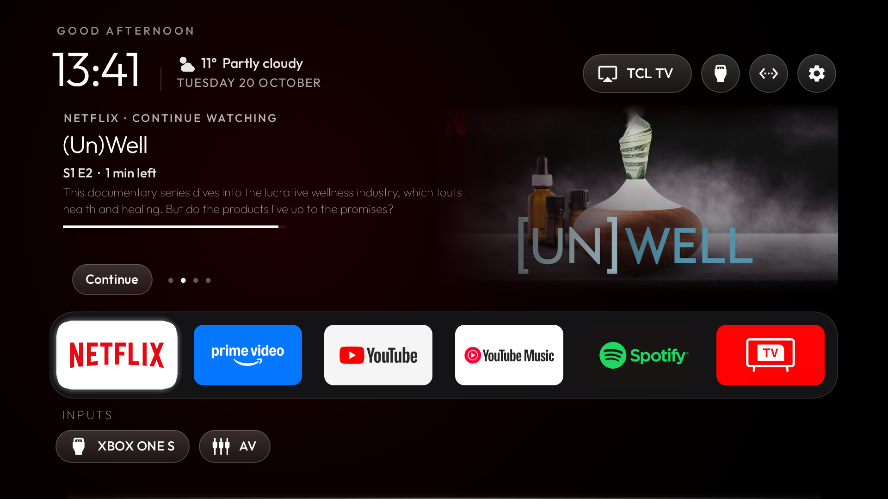

# SBL (Slightly Better Launcher)

A home screen for Android TV. The apps you use most sit in one row. Focus one and the home screen shows what you
were watching in it. The APK is about 480 KB. There are no ads, no account and no analytics.



Version 0.1. Android 8.0 or newer (API 26). Package name `com.bbu.sbl`.

## Privacy: read this first

Any request over the internet shows the TV's IP address to the server that answers. SBL makes few requests, and the
weather is off until you turn it on.

- **Weather is off on a fresh install.** SBL asks once, the first time the home screen is up, whether to turn it on.
  The answer is saved and the question does not come back. Change it later under Settings, Home screen, Weather.
  Off means no weather requests at all.
- **Where the TV is.** The weather needs a position. SBL uses the TV's last known location when Android has one.
  Otherwise it asks geojs.io for a rough, city-level position of the TV's IP address. geojs.io is the only location
  service SBL calls. It was chosen because its privacy policy says it keeps no access logs.
- **What each service sees.** geojs.io sees the TV's IP address. Open-Meteo, which supplies the weather, sees the
  TV's IP address and the rounded position it is asked about. Nothing else is sent: no account, key or device ID.
- **Automatic appearance** needs the same position, so choosing it can also make the geojs.io request, even with the
  weather off. Dark and Light never use the network.
- **Posters.** Some apps publish their Watch Next posters as web addresses. SBL loads each one from exactly the address
  the app gave, usually the app's own server or its image CDN, so that server sees the TV's IP address too. Posters
  an app shares from the TV itself involve no network at all. This only happens when Watch Next is on.

Nothing else leaves the TV. Watch Next data is read from the system's TV provider and stays on the TV.

## What it does

**Home screen.** The top bar has the time, the date and, if you turned it on, the weather. On the right are the TV's
AirPlay name (when an AirPlay receiver is running), the inputs menu, the network (Wi-Fi name or Ethernet, with a VPN
badge) and settings. Under it is the favourites row: 4 to 8 apps, 6 by default. Under the row, connected HDMI and AV
inputs are listed by the names the TV gives them. Other apps stay hidden until you press Down.

**Watch Next.** Focus a favourite and SBL shows up to four Watch Next or featured items that app publishes: the kind
of item, title, season and episode, minutes left, progress, description and poster. Items you are partway through
come first. The items turn every 6, 10 or 30 seconds, or never. Press Up from the row to take over: Left and Right
change the item, OK opens it in its app, Down goes back. Apps that publish nothing just show their name.

Android asks once whether SBL may read TV listings. Without that permission this part stays empty and everything
else works.

**Apps.** Sort alphabetically, by recent use, by most use, or manually. Hold OK on a tile to move it, open its App
info, hide it, or add it to or remove it from the favourites.

**Settings.** The gear button opens SBL settings and the TV's own settings. SBL settings has four pages:
- Home screen: language, appearance, columns, inputs row, Watch Next, weather (on or off, Celsius or Fahrenheit),
  module cards.
- Apps: sort order, hidden apps, clearing usage counts.
- Permissions: what SBL can use, with a shortcut to Android's page for it.
- Backup, reset and about.

**Appearance and language.** Appearance is dark, light, or automatic (light by day, dark from sunset to sunrise at
the TV's position; the sun is calculated on the TV). SBL speaks English, Turkish, Spanish, French, German, Russian,
Ukrainian, Portuguese, Czech and Polish. It follows the TV's language, uses English when it has no translation, and
you can pick a language in the settings.

**Backup and restore.** A backup is one small JSON file with every setting, the favourites, the manual order, the
hidden apps and the usage counts. It goes to a `SlightlyBetterLauncher` folder on the TV and on any USB drive that
accepts it. The five newest are kept. It survives uninstalling, so it is the way to move to a new version or TV.
It needs Android's "All files access", which the Permissions page opens.

**Module cards.** An app can offer its own labelled tile, after you agree to it. See
[`launcher/CARDS.md`](launcher/CARDS.md).

## Install

Without ADB: copy `SlightlyBetterLauncher.apk` from [`dist/`](dist/) to the TV, open it from a file manager and allow
installs from that app. SBL is an ordinary app until you make it the Home screen. If the TV asks which launcher to use
when you press Home, pick SBL and choose Always.

With ADB:

```bash
adb connect <tv-ip>:5555
adb install -r SlightlyBetterLauncher.apk
adb shell am start -n com.bbu.sbl/.MainActivity
adb shell pm grant com.bbu.sbl android.permission.READ_TV_LISTINGS
adb shell appops set com.bbu.sbl MANAGE_EXTERNAL_STORAGE allow
```

The last two lines grant the permissions from the computer instead of on the TV.

### Making SBL the Home screen with ADB

Only needed if pressing Home does not offer SBL. Disabling the TV maker's launcher can remove things you may want.

1. See which app owns Home now:

   ```bash
   adb shell cmd package resolve-activity --brief -a android.intent.action.MAIN -c android.intent.category.HOME
   ```

   If the answer is `android`, Android is showing a chooser: pick SBL there and you are done. Otherwise note the
   package, for example `com.google.android.tvlauncher`.

2. Disable it for your user (nothing is deleted) and set SBL as Home:

   ```bash
   adb shell pm disable-user --user 0 <package-from-step-1>
   adb shell cmd package set-home-activity --user 0 com.bbu.sbl/.MainActivity
   ```

   On Google TV the setup wizard (`com.google.android.tungsten.setupwraith`) can also claim Home. If step 1 still does
   not name `com.bbu.sbl`, disable it the same way.

3. To go back at any time:

   ```bash
   adb shell pm enable --user 0 <package-from-step-1>
   ```

## Build from source

You need JDK 17 or newer and the Android SDK (`ANDROID_HOME`).

```bash
cd launcher
./gradlew assembleRelease            # app/build/outputs/apk/release/SlightlyBetterLauncher.apk
TV_HOST=192.168.1.50 ./install.sh    # build, install and start it on a TV (install.ps1 -TvHost ... on Windows)
```

The release build is signed with the key named in `launcher/keystore.properties`, which is not committed:

```properties
storeFile=/path/to/sbl-release.jks
storePassword=...
keyAlias=sbl
keyPassword=...
```

Without that file it falls back to the Android debug key. A TV only accepts an update signed with the same key as the
installed app. With a different key you must uninstall first, which deletes the app's settings, so back up before.

The APK in `dist/` is signed with the certificate whose SHA-256 fingerprint is
`5A:7B:1F:73:8F:3C:C0:99:5C:E6:6B:91:9D:64:20:E3:E1:76:E5:0C:8B:3F:60:08:BB:53:D4:ED:7D:B2:6E:CC`.

## Limits

- Tried on one TV, a TCL running Android TV 11. Watch Next, input names and switching the Home screen differ between
  makers.
- Many TVs compose the interface at 1080p even on a 4K panel (`adb shell wm size`). SBL cannot draw sharper than the
  system allows.
- Themes exist in the code (see [`themes/`](themes/README.md)) but are switched off in the settings for now.

## Licence

Copyright (c) 2026 BBU. MIT licence, see [`LICENSE`](LICENSE). The file also carries the copyright notice of the code
SBL is built on, as the licence requires. The Outfit typeface is under the SIL Open Font License 1.1
([`launcher/FONT-LICENSE-OFL.txt`](launcher/FONT-LICENSE-OFL.txt)).
